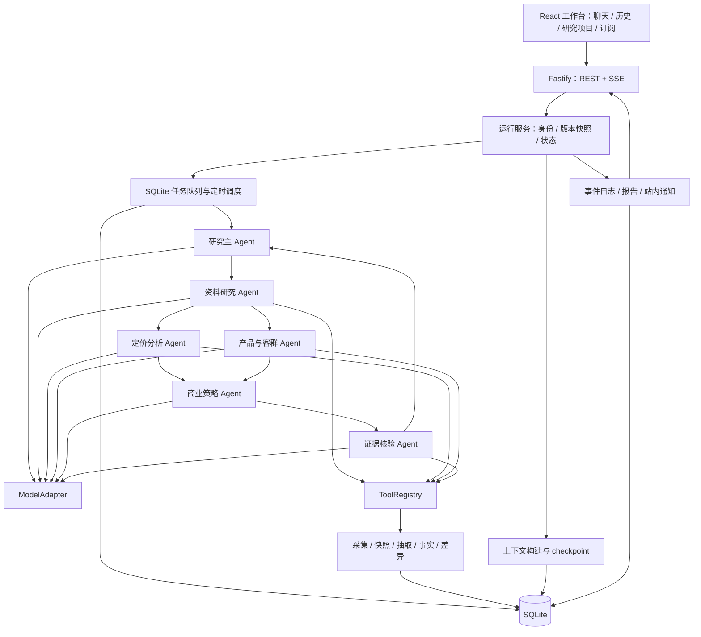

**AI 商业化竞品分析 Agent 工作台技术方案**

版本：v1.0；日期：2026-11-01。本文是待实施设计，验收指标均为目标值，当前未交付应用代码或实测结果。

建议以“AI 商业化竞品分析”作为 Agent 子应用复刻的验证场景：帮助产品经理、商业化团队持续研究同类 AI 产品的定价、套餐权益、客户定位、产品能力和商业化变化，生成有证据的对比报告，并支持订阅和历史追问。

本方案延续既定范围：复刻聊天界面、多 Agent、ReAct、任务发布订阅、上下文与历史记录；Agent 编排自行实现，数据使用 SQLite。首期为单机小团队版本。

场景默认聚焦“AI 营销文案与素材生成 SaaS”，研究 3 个同类产品和可选的己方产品。选择同类、同地区、同客户类型的对象，避免把通用助手、基础模型 API 和营销 SaaS 直接放在同一价格榜中。具体竞品由用户在工作台配置，本文示例产品 Alpha、Beta、Gamma 均为虚构测试对象。

**这项产品的交付物是可追溯的研究结论。**

用户输入示例：

> 分析 Alpha、Beta、Gamma 面向中小电商团队的商业化策略，比较月付、年付、团队席位、生成额度、商用授权、API 和企业能力。结合我方产品资料提出差异化建议。以后每天北京时间 9 点检查，价格变化超过 10%、商用授权变化或关键功能变化时通知我。

系统创建研究项目，固定本次研究范围、目标客户、地区、币种、计费口径、截止时间和资料版本；完成采集、抽取、计算、分析、核验，交付以下内容。

| 产物 | 内容 |
|---|---|
| 竞品对比矩阵 | 产品定位、能力、价格、额度、席位、授权、API、企业服务，每个事实可打开证据 |
| 商业化分析报告 | 客群、收费方式、套餐梯度、转化路径、产品差异、己方机会和待验证假设 |
| 定价计算表 | 年付总额、月均等价成本、最低席位、超额费用与限制 |
| 变化报告 | 本次与前次成功观察的变化、旧值、新值、变化幅度和前后证据 |
| 证据库 | 来源、快照、相关原文、采集时间、声明时间、支持或冲突关系 |
| 任务与订阅记录 | 执行版本、过程、失败原因、通知记录、后续追问 |

所有报告区分“已核实事实、来源声明、分析推断、未知项”。供应商官网对效果的宣传只能标注为来源声明；缺少公开营收、付费用户、转化率或市场份额时保留未知，不从流量、搜索热度或价格推算为事实。公开页面未披露某功能，也不直接等同于不支持。

首期包含网页与 TXT、Markdown、CSV、文本型 PDF 输入、站内通知，以及 Markdown、HTML、CSV 导出。扫描件 OCR、付费数据库、登录后产品实测、付费墙内容、外部消息渠道、账单支付和跨机器集群作为后续扩展。首期不能仅凭公开页面证明真实付费体验或产品实际效果。

**复刻以原 Agent 子应用为参照，运行系统独立建设。**

| 原项目模块 | 参考位置 | 实施方式 |
|---|---|---|
| 聊天、输入、按轮渲染 | [聊天入口](/Users/bytedance/tool_platform/apps/agent/src/routes/deepagents-chat/index.tsx:23) | 延续组件分层和交互，替换路由、别名、接口和共享包 |
| 执行过程展开与收起 | [ExecutionTrace](/Users/bytedance/tool_platform/apps/agent/src/routes/deepagents-chat/components/ExecutionTrace.tsx:25) | 保留成功折叠、错误及等待确认展开的行为 |
| 创建、控制、订阅 Run | [运行 Hook](/Users/bytedance/tool_platform/apps/agent/src/routes/deepagents-chat/hooks/useDeepAgentRun.ts:13) | 对齐为独立 REST 与 SSE 协议 |
| 主 Agent 和业务子 Agent | [Runtime Builder](/Users/bytedance/tool_platform/apps/agent/api/service/deepagents/runtime/builder.ts:331) | 重写为自研执行循环与调度器 |
| 发布和版本快照 | [发布逻辑](/Users/bytedance/tool_platform/apps/agent/api/service/digital-employee/lifecycle.ts:595) | 保留草稿校验、发布不可变版本、运行快照 |
| 领域上下文 | [SubAgent thread](/Users/bytedance/tool_platform/apps/agent/api/service/deepagents/shared/subagent-thread.ts:11) | 建设按研究项目和 Agent 版本隔离的上下文 |
| checkpoint | [原 checkpoint](/Users/bytedance/tool_platform/apps/agent/api/service/deepagents/shared/checkpointer.ts:9) | 用 SQLite 自定义序列化状态替换框架 checkpoint |

这些原代码路径来自此前关键链路阅读，属于方案依据，不代表原系统已经运行验收。源项目只读，复刻实现写入当前工作目录。

工程依赖移除范围包含 langchain、@langchain/*、deepagents，以及绑定这些框架的观测和 checkpoint 适配器。交付时检查源码导入和生产依赖树，避免间接引入。数据库、模型 SDK、HTML/PDF 解析库和 UI 库可使用成熟实现，编排控制权由项目代码持有。

**技术栈采用全栈 TypeScript，降低协议和状态映射成本。**

| 层 | 选择 | 作用 |
|---|---|---|
| 工程 | pnpm workspace、TypeScript、锁定依赖版本 | 共享领域类型和构建配置 |
| 前端 | React 18、Vite、React Router | 独立聊天工作台 |
| UI | Semi Design、CSS Modules、react-markdown、remark-gfm | 复用原交互风格，呈现表格、报告、工具卡片 |
| 状态 | Zustand、TanStack Query | 分开管理流式状态和服务端缓存 |
| API | Node.js 24 LTS、Fastify、JSON Schema/Ajv | REST、SSE、参数验证、工作空间权限 |
| Agent | 自研 Runtime、原生结构化工具调用 | ReAct、委派、预算、审批、恢复 |
| 模型 | ModelAdapter + 厂商官方 SDK 或 HTTP | 适配工具调用、流式增量、用量和错误 |
| 采集 | fetch、受控 Chromium/Playwright worker | 静态页面优先，必要时渲染动态页面 |
| 解析 | Cheerio、Readability、PDF.js | 定价表与正文分别提取；PDF 文本和页码提取 |
| 存储 | better-sqlite3、SQLite、SQL migrations | 业务、快照、队列、事件、历史与产物 |
| 检索 | FTS5、中文预分词、产品及字段过滤 | 证据、历史、业务知识召回 |
| 测试 | Vitest、Playwright Test、固定资料集 | 计算、恢复、采集适配和界面验收 |
| 运维 | 结构化日志、usage_records、健康检查 | 耗时、失败、预算、来源覆盖率 |

Fastify 的路由校验支持 JSON Schema；Schema 由工程代码维护，用户只填写参数。[Fastify 官方文档](https://fastify.dev/docs/latest/Reference/Validation-and-Serialization/)

Node.js 24 处于官方 LTS 支持期，运行时与驱动的具体补丁版本在实施时锁定并验证。[Node.js 发布计划](https://github.com/nodejs/Release)

正文抽取可使用 Readability；定价卡片、比较表和脚注还须由 DOM 结构解析保留，不能只使用正文阅读模式，否则会丢失计费条件。[Readability 官方仓库](https://github.com/mozilla/readability)

首期不需要独立向量数据库。若实际验证发现关键词检索不足，再增加 Embedding 适配层，向量仍可存入 SQLite；扩展依据为召回测试结果。

**系统按应用层、运行层和证据层组织。**



默认部署一个 API/调度进程、一个受控采集 worker、少量解析 worker，同机使用本地 SQLite 文件。模型调用异步并发，浏览器和 PDF 解析放到 worker，避免阻塞 API。数据库写入串行化或使用短事务竞争，不跨网络文件系统共享 WAL 数据库。

**多 Agent 采用主从委派和有向无环任务依赖。**

| Agent | 输入与职责 | 输出与限制 |
|---|---|---|
| 研究主 Agent | 明确研究范围、生成计划、委派、汇总、处理追问 | 任务树、最终报告；版本和预算贯穿子任务 |
| 资料研究 Agent | 按竞品寻找官网、定价、帮助、条款、更新日志 | 来源候选和快照引用；不把搜索摘要当最终证据 |
| 定价分析 Agent | 抽取套餐、核对脚注、调用定价计算工具 | 可比较价格表、计算依据、不可比较项 |
| 产品与客群 Agent | 分析公开能力、客户定位、套餐权益和用户旅程 | 能力矩阵、来源声明、未知项 |
| 商业策略 Agent | 结合已核验事实与己方资料提出差异化策略 | 假设、机会、依据、下一步验证动作 |
| 证据核验 Agent | 核对引用、事实支撑、价格口径、冲突和新鲜度 | 通过项、驳回项、缺证项及发布状态 |

第一批按竞品并行采集；随后定价与产品分析可并行；策略依赖前两类结果；最终报告经核验后发布。核验发现缺证时最多自动补采一轮，仍不满足则发布部分报告并标出缺口。单次简单追问只调用必要 Agent，避免每轮固定启动全部角色。

初始并发建议：模型请求总并发 3，浏览器页面并发 2，同源采集并发 1；这些值可配置，最终按实测调整。限制父子任务总模型调用数、工具调用数、委派深度、网页数、总耗时和费用预算。重试、补采、摘要和最终收尾都计入预算，提前为收尾预留额度。

每个任务记录 taskId、parentTaskId、agentVersionId、目标、输入引用、依赖、输出 Schema、工具权限、预算和截止时间。子 Agent 返回 status、summary、claimIds、snapshotIds、artifactIds、unresolvedQuestions；主 Agent 按引用读取必要内容。

Runtime 向有委派权限的主 Agent 提供 delegate_tasks、wait_tasks、get_task_result；这些是受控内置工具。delegate_tasks 校验目标 Agent 白名单和任务依赖后写入队列，wait_tasks 将父任务置为 waiting_children 并释放执行槽；子任务完成事件满足等待条件后重新入队父任务。子任务只能访问显式输入和其可见资料，取消与剩余预算沿父子关系传播，避免父任务占住全部槽位导致子任务无法运行。

**ReAct 使用明确的执行阶段和持久化边界。**

执行顺序为：加载运行快照和上下文 → 请求模型 → 获得最终回复或结构化工具调用 → 校验并持久化调用 → 执行工具 → 持久化结果 → 将结果交回模型 → 继续或结束。模型工具调用增量须完整拼接并通过 Schema 校验后才能执行。

核心模块为 ModelAdapter、ReactRunner、ToolRegistry、Coordinator、TaskScheduler、ContextBuilder、CheckpointStore、EventStore、EvidenceService、ReportService。模型适配层输出统一的文本增量、工具调用、结束原因和用量，不将厂商消息对象扩散到领域层。

工具接口示意：

```ts
interface ToolSpec<I, O> {
  name: string;
  description: string;
  inputSchema: object;
  effect: 'read' | 'internal_write' | 'external_write';
  timeoutMs: number;
  retryPolicy: 'safe' | 'verify_first' | 'never';
  execute(input: I, context: ToolContext): Promise<O>;
}

interface ToolContext {
  workspaceId: string;
  runId: string;
  taskId: string;
  callId: string;
  idempotencyKey: string;
  signal: AbortSignal;
}
```

页面展示任务计划摘要、工具动作、证据和结论。工具具有固定 Schema 和权限，由 Runtime 处理异常、超时、重试、循环检测与取消。

运行状态包含 queued、running、waiting_children、waiting_user、cancel_requested、completed、partial、failed、cancelled。状态变更校验前置状态和 revision；partial 用于研究有结果但证据覆盖未达完整标准的情况。取消后停止派发新任务，传播 AbortSignal，等待或核验在途动作，再形成最终状态。

checkpoint 保存 stage、消息引用、待执行工具调用、已完成工具结果、子任务引用、预算、配置快照和审批信息。每个已持久化执行阶段均可恢复，不能恢复未被模型服务提交的半段推理；模型请求中断可能需要重发并产生额外费用，记录为新 attempt。

**采集与证据建设是这个场景的业务核心。**

| 工具 | 行为 |
|---|---|
| search_web | 经服务端 SearchProvider 查找候选页面；返回链接和发现信息 |
| fetch_page | 抓取静态页面、记录最终 URL、HTTP 状态和缓存验证头 |
| render_page | 对必要动态页面创建隔离浏览器上下文并获取可见内容 |
| import_document | 导入用户资料和文本 PDF，保存文件摘要与来源 |
| extract_claims | 从固定快照生成带定位信息的候选事实 |
| query_evidence | 按产品、字段、时间、来源、关键词检索证据 |
| normalize_pricing | 用确定性计算规则处理套餐口径 |
| compare_snapshots | 比较前后结构化事实，生成变化候选 |
| verify_claims | 校验引用存在性、定位、口径、冲突和覆盖 |
| generate_report | 由结构化报告生成 Markdown、HTML、CSV |

SearchProvider 提供 fixture 和 live 两种实现。live 通过可配置的 Web Search API 接入，凭证留在服务端。缺少搜索服务时仍可输入官方 URL 完成研究，系统明确标注来源发现范围受限。规划中的生产采集接口与当前对话可用的搜索工具分开建设。

来源优先选择官网定价页、帮助中心、条款、官方发布与文档，再使用可信第三方补充。论坛、测评和用户评论用于提出调查线索，不独立支撑官方套餐价格等关键事实。每个项目允许配置权威域名和来源范围。

采集先 fetch，只有正文或定价结构无法提取时才渲染浏览器。浏览器上下文按任务隔离，完成后销毁；不复用用户日常浏览器身份。[Playwright BrowserContext 文档](https://playwright.dev/docs/api/class-browsercontext)

URL 抓取校验协议、域名、DNS 解析地址及每次跳转，阻断访问本机、内网和云元数据地址；设置来源访问规则、robots/条款策略、限速、响应体与解压大小上限。无法访问的页面记录失败，支持用户提供资料；不将访问失败解释为产品能力缺失。fixture 直接读取测试快照，不通过放开内网访问完成回放。

每次采集记录 requestedUrl、canonicalUrl、finalUrl、fetchedAt、HTTP 状态、语言、地区、原始内容 hash、规范化内容 hash、解析器版本。sourcePublishedAt 和声明生效时间只有来源明确给出时填写。抓取时间只证明“此时观察到”，不能倒推为之前已经存在。

原始 HTML/文本/PDF 和必要截图压缩存入 SQLite BLOB；Snapshot 描述不可变内容；FetchAttempt 单独记录每次检查结果。返回 304 时沿用已有快照并记录新的检查时间。ETag 可用于条件请求，但仍需建立失败、缺少缓存头及页面实际变化的分支。[If-None-Match 文档](https://developer.mozilla.org/en-US/docs/Web/HTTP/Reference/Headers/If-None-Match)

规范化阶段去除导航、时间戳和广告等噪声，同时保留定价脚注、权益限制及地区条件。先比较内容 hash，再抽取结构化字段做语义变化判断，避免标点或布局变化触发商业告警。

候选事实的最小结构如下：

```text
claimId / workspaceId / competitorId / productId
fieldPath / typedValue / unit / region / qualifiers
snapshotId / chunkId / exactQuote / startOffset / endOffset
observedAt / declaredEffectiveAt? / extractorVersion
claimType: fact | vendor_statement | inference
verificationStatus: candidate | verified | disputed | unsupported
```

同一断言允许多条支持或反驳证据；引用定位到不可变快照中的文本，偏移统一按 Unicode 码点计数并绑定规范化文本 hash，PDF 额外保留页码。schema、数值和引用存在性由程序核验，语义蕴含由核验 Agent 加抽样人工检查；模型复核通过不等同于事实绝对正确。

报告中的事实、推断和建议分开存储。所有价格、额度、商用授权等关键事实都要求证据；无证据则输出 unknown 或待核实。发现官方不同页面冲突时展示冲突及时间条件，不能让模型静默选择一个值。

**定价比较必须保留计费条件。**

PricePlan 记录 planName、currency、amount、billingPeriod、billingCommitment、priceUnit、minimumSeats、includedQuota、quotaUnit、overage、taxIncluded、region、promotion、commercialRights 和 evidenceIds。金额使用整数最小货币单位或十进制字符串，计算使用 decimal.js，避免浮点误差。

| 情况 | 处理规则 |
|---|---|
| 月付与年付 | 同时展示真实应付总额和月均等价值，保留年付承诺 |
| 按席位收费 | 计算指定团队规模和最低席位约束下的总额 |
| 不同币种 | 默认分币种比较；换算须有固定日期汇率来源 |
| 生成额度 | 仅对相同单位比较；不同模型、质量或 credits 定义保留差异 |
| 免费与试用 | 记录额度、有效期、商用限制和是否需要支付信息 |
| 企业议价 | 标记 contact_sales，不填成 0 |
| 限时优惠 | 与常规定价分开，记录适用和失效条件 |
| 缺失字段 | 保存 unknown，不转为 false、免费或无限制 |
| 价格变化 | 只有币种、地区、周期、席位和套餐语义可对齐时计算百分比 |

评分仅在用户选择比较目标、权重和规则时启用。评分规则、覆盖率及缺证项随报告保存；默认优先对比矩阵和适用场景，不生成无依据的综合排名。

**发布和订阅分别覆盖配置、任务消费与结果通知。**

| 对象 | 发布 | 消费或订阅 |
|---|---|---|
| Agent | 草稿校验后发布不可变规格版本 | 新 Run 固定主子 Agent、提示词、工具版本 |
| 研究模板 | 固定维度、来源策略、输出 Schema 和预算 | 用户创建一次性或周期研究任务 |
| 执行任务 | 聊天、调度器、父任务写入 tasks | 指定 Agent 或能力消费组领取 |
| 运行事件 | 写入 run_events | 前端订阅执行过程与回复 |
| 商业变化 | 经核验的 change_set | 用户按项目、产品、字段和阈值订阅站内通知 |

执行队列使用至少一次投递。领取任务在短事务内更新 leaseOwner、leaseUntil、leaseVersion 和 attempt；续租与结果提交均校验租约版本，防止过期 Worker 提交。模型和网络操作发生在数据库事务之外。使用任务依赖避免并行执行尚未满足前置条件的分析。

执行消费组由已发布 Agent 注册能力和工具权限，同一消费组内竞争领取一个任务；定向委派优先指定 Agent 版本。观察事件和结果通知使用各自的订阅记录，不竞争执行任务。浏览器读取、抽取和模型请求可重复尝试；创建报告、建立订阅、写入告警等内部写操作由幂等键与事务保证一个逻辑结果。

任务、状态变更和对应事件在同一事务提交。内存事件总线只能加速通知，SQLite 是可靠来源。RunEvent 包含 runId、seq、type、taskId、parentTaskId、payload、createdAt 和 schemaVersion，唯一键为 (runId, seq)。

SSE 提供快照和 seq 之后的事件，客户端保存游标并去重。订阅连接断开不取消后台任务，取消通过独立 API。流式文本先合并为小批量事件持久化，再发送；重连回放、实时补发与结束快照都按序号处理。原生 EventSource 可携带 Last-Event-ID；fetch 流由客户端实现相同游标语义。[SSE 标准](https://html.spec.whatwg.org/dev/server-sent-events.html)

调度器持久化 nextFireAt、时区和并发策略，定时任务不依赖内存 timer 的存活。每天 9 点使用 Asia/Shanghai 解释并转换为 UTC 入库。以 (scheduleId, scheduledFor) 唯一约束避免重复触发。默认同一订阅串行，错过多轮只补最近一次；失败重试单独留记录。

商业变化告警基于 verified 字段差异，形成指纹 (subscriptionId, oldFactVersion, newFactVersion, ruleVersion)。在同一事务创建告警、站内通知 outbox 并推进基线；通知投递失败重试不重新创建告警。初次执行只建立基线；采集失败、字段冲突或信息不足时不推进该字段基线，也不报告“价格取消”或“功能下线”。

无变化时保持安静；规则匹配的变化、持续采集失败或需要用户处理时生成通知。订阅暂停、恢复和删除均可在工作台操作。周期研究保存模板版本，升级版本是显式操作，已有执行保持快照。

**上下文由结构化项目资料、历史、证据和执行状态共同构成。**

| 层 | 内容 | 注入方式 |
|---|---|---|
| 系统 | 职责、工具权限、事实标准 | 来自发布版本，始终保留 |
| 项目 | 竞品集合、客群、地区、比较目标、己方产品资料 | 项目级，保留资料版本 |
| 任务 | 当前问题、范围、截止时间、预算 | 当前 Run 固定 |
| 会话 | 最近完整轮次、旧轮次摘要、用户明确约束 | 按输入预算选择 |
| 证据 | 相关 claim、来源快照和冲突 | 按产品、字段、时间和来源检索 |
| 执行 | 工具结果引用、子任务状态、审批 | 来自 checkpoint |

输入预算根据模型 context window 计算，扣除输出和工具开销后选择证据。摘要触发阈值配置化；摘要必须保留目标、约束、关键证据 ID、未知项与待确认事项，原始历史不删除。工具调用和结果作为完整对保留，避免只保留一半。

业务 Agent 的长期领域状态按 workspaceId、researchProjectId、agentId 和版本隔离；当前子任务 scratchpad 按 taskId 隔离。跨研究复用经过检索选择，事实按 observedAt 和版本过滤，不能把旧报告结论自动当成本次现状。

网页、上传资料和工具结果作为不可信资料输入，不能授权工具或覆盖系统规则；工具执行权限始终由服务端校验。明确用户偏好可经规则校验保存，分析推断保持假设状态。所有检索先限制工作空间和资料可见性。

FTS5 使用预分词关键词索引；中文短词和产品别名另建字段索引或受限范围 LIKE 查询。trigram 可补充较长子串召回，但少于 3 个 Unicode 字符的 MATCH 不命中，因此不能单独承担中文短词检索。[FTS5 官方文档](https://www.sqlite.org/fts5.html)

**历史记录应能回答“当时看到了什么”和“现在变化了什么”。**

每份报告保存 reportVersion、scopeSnapshot、agentVersionRefs、modelProfile、promptHash、toolVersions、parserVersions、schemaVersion、evidenceIds、cutoffTime 和生成用量。报告正文和 CSV 作为不可变产物保存，因此历史展示可以准确复现；重新调用模型生成报告不保证逐字相同。

追问默认沿用报告的证据时间范围；“现在是否变化”触发刷新采集。历史比较以旧快照和新快照为依据，不能在没有当期资料时补造某个过去日期的状态。报告中标明观察时间与来源声明的生效时间。

会话支持搜索、重命名、删除、分页和执行过程回放。周期任务创建项目下独立研究 Run，不向交互会话无序插入大量消息；报告与通知可以跳转到对应 Run。删除运行中的会话先取消任务；删除项目按引用计数清理快照、附件、FTS、记忆、checkpoint 和通知，保留有明确保留策略的审计记录。

**SQLite 表结构同时承载通用 Runtime 和竞品领域。**

| 分组 | 表与核心字段 |
|---|---|
| 身份 | users；workspaces；memberships(workspace_id, user_id, role)；sessions |
| Agent | agents(draft_revision, draft_spec, active_version_id)；agent_versions(agent_id, version, spec_json) |
| 研究项目 | research_projects(scope_json, own_product_version_id)；competitors；products；source_policies |
| 模板订阅 | research_templates；template_versions；schedules(timezone, next_fire_at)；subscriptions(rule_json, baseline_json) |
| 会话 | conversations(project_id, owner_id, title)；turns；messages(role, content_json, status) |
| 执行 | runs(config_snapshot, status, revision)；tasks(parent_id, agent_version_id, lease_until, lease_version, attempt)；task_dependencies |
| 过程 | run_events(run_id, seq, type, payload)；tool_calls(idempotency_key, state)；tool_results；checkpoints |
| 来源 | sources(url, authority)；fetch_attempts(status, checked_at)；source_snapshots(content_hash, observed_at, parser_version) |
| 证据 | document_chunks(snapshot_id, location)；claims(field_path, value_json, qualifiers_json, verification_status)；claim_evidence(relation, locator) |
| 定价 | price_plans(typed_fields, qualifiers, evidence_refs)；pricing_calculations(input_refs, formula_version, result_json) |
| 报告 | reports(version, scope_snapshot, evidence_manifest, status)；report_claims；change_sets；change_items |
| 上下文 | context_summaries；memories(source_ref, valid_scope, expires_at) |
| 产物 | artifacts(mime_type, blob_id, hash)；blobs(content, compression, byte_length) |
| 通知 | alerts(fingerprint, change_set_id)；notification_outbox；notification_deliveries |
| 用量 | usage_records(model_profile, tokens, estimated_cost, actual_cost_if_known, duration_ms) |

必须具备的约束包括：Agent 版本唯一、Run 事件序号唯一、定时触发唯一、工具幂等键唯一、告警指纹唯一、报告版本唯一。快照在授权范围内按内容 hash 去重，避免跨工作空间泄露文档存在性。

常用索引包括 tasks(status, available_at, lease_until)、run_events(run_id, seq)、conversations(workspace_id, updated_at)、claims(workspace_id, product_id, field_path, observed_at)、fetch_attempts(source_id, checked_at)、notification_outbox(status, next_attempt_at)。同一会话只允许一个交互写入 Run 活跃，周期研究通过项目级任务锁和订阅串行策略控制。

初始化建议开启 foreign_keys、journal_mode=WAL、busy_timeout；对需要断电持久化的业务采用 synchronous=FULL。SQLite WAL 仍然只有一个写入者，因此压缩大文件、浏览器处理和模型请求在事务外完成，批量导入和流式事件使用小批次。单机验证不承诺多机器共享写入。[SQLite WAL 文档](https://www.sqlite.org/wal.html)

快照正文默认压缩保存，HTML/PDF 及截图设置不同大小限制和保留策略；被报告引用的证据在报告保留期内固定。备份覆盖数据库与 BLOB，使用一致性备份 API，并验证从备份恢复后的引用完整性。[SQLite Backup API](https://www.sqlite.org/backup.html)

**接口与工程模块边界应在实现前固定。**

| 接口 | 作用 |
|---|---|
| POST /api/projects；GET/PATCH /api/projects/:id | 创建和维护研究范围 |
| POST /api/projects/:id/competitors | 配置竞品、产品和官方来源 |
| POST /api/documents | 上传己方资料或竞品资料 |
| POST /api/agents/:id/versions | 校验并发布 Agent |
| POST /api/research-templates/:id/versions | 发布可执行研究模板 |
| POST /api/conversations；GET /api/conversations | 会话创建和分页查询 |
| GET/PATCH/DELETE /api/conversations/:id | 历史详情、重命名和删除 |
| POST /api/runs | 提交消息或研究任务，返回 Run ID 和订阅地址 |
| GET /api/runs/:id；GET /api/runs/:id/events?afterSeq= | 运行快照与 SSE |
| POST /api/runs/:id/cancel；POST /api/runs/:id/decisions | 取消、确认或拒绝待处理操作 |
| GET /api/reports/:id；GET /api/reports/:id/export | 报告与导出 |
| GET /api/claims/:id；GET /api/snapshots/:id | 查看证据与受控快照 |
| POST /api/subscriptions；GET /api/subscriptions | 创建和查询订阅 |
| PATCH/DELETE /api/subscriptions/:id | 修改、暂停、恢复或删除订阅 |
| GET /api/projects/:id/changes；GET /api/notifications | 变化列表和站内通知 |

所有资源接口校验工作空间和成员权限；修改接口接收 revision 或幂等键；列表使用 cursor 分页；错误返回 code、message、retryable 和 requestId。HTML 快照和报告在隔离预览中展示，清除脚本、事件处理器和危险 URL，避免存储型脚本执行。

浏览器与前端采用同源 Cookie 会话，写接口做 CSRF 校验；服务端保存模型和搜索服务密钥，密钥不进入证据、日志、工具结果或前端。用户只读资料和运行权限在每次恢复时重验。

建议在当前工作目录建设如下模块，以下为规划结构：

```text
apps/web/                     聊天、项目、证据、报告、订阅
apps/server/                  API、会话、权限、SSE、启动恢复
apps/worker/                  浏览器采集和解析
packages/contracts/           API、事件和领域 Schema
packages/agent-runtime/       ReAct、协调、预算、状态机、checkpoint
packages/storage/             SQLite repository、迁移、事务
packages/research-domain/      定价、断言、变化、报告规则
packages/research-tools/       搜索、采集、抽取、计算、核验
fixtures/competitive-analysis/ 固定资料、两期快照和黄金答案
docs/                         技术方案、部署与验收说明
```

**界面效果围绕聊天组织，证据和研究管理按需展开。**

左侧保留新会话和历史列表，增加研究项目和订阅入口；中间按轮展示问题、研究计划、Agent 执行卡片和最终报告；右侧展示证据、前后变化或报告预览。输入区支持选择研究 Agent、附加资料、发送和停止。

Agent 卡片显示角色、当前任务、状态、耗时和产物引用。成功后自动折叠过程；失败、部分完成和等待确认时保持展开。报告中的引用打开原文定位、URL、快照采集时间和核验状态。原始 HTML 预览独立隔离。

订阅面板明确展示竞品集合、比较维度、触发频率、时区、告警规则、预计预算上限和是否启用。用户提交完整的定时订阅指令即构成创建授权，普通分析不会自动变为周期任务。高费用范围扩展或外部发布需要用户明确操作；当前一期通知仅在站内展示。

典型结果示意：

```text
你：比较三个竞品的定价和商用授权。

资料研究：已完成 3 个竞品的来源检查
定价分析：已完成；1 项年付条件需要说明
产品分析：已完成；2 项公开信息未知
证据核验：通过 18 项，保留 2 项未知

报告 v1：对比矩阵 / 商业策略 / 待验证假设
每条关键事实可点击证据，CSV 可下载。

后续通知：Alpha 月付价格变化 +34.48%
旧值 $29/月 → 新值 $39/月
查看前后证据、变化报告和原始研究记录。
```

该示意为虚构测试数据，不代表真实产品价格或已经完成的分析。

**验证分为固定回放、真实采集和业务试用三个层次。**

固定回放使用 Alpha、Beta、Gamma 三个虚构 AI 营销 SaaS、约 30 份资料，以及两期快照、结构化黄金事实、预期变化和来源引用。fixture 与 live 共用领域处理链路，只替换搜索和采集适配器；fixture 不会被当作线上事实。

| 用例 | 预期行为 |
|---|---|
| Alpha 月付从 USD 29 变成 USD 39，其余条件相同 | 确定性计算 +34.48%，命中超过 10% 的规则 |
| Beta 标示 USD 19/月，实际按年付 USD 228 | 同时展示 USD 228/年与月均 USD 19，注明年付承诺 |
| 套餐每席位收费且最低 3 席 | 指定 2 人团队时仍按最低 3 席计算，并说明条件 |
| 相同字段一处写 unlimited，帮助页规定合理使用 | 保留限制及冲突，不输出无条件无限额度 |
| Gamma 没有公开 API 文档 | 输出“未发现公开证据”，不能输出“不支持 API” |
| 标点、导航、页面时间变化 | 不生成价格或权益变化告警 |
| 一次超时或 403 | 记录采集失败，不生成下线告警，不推进基线 |
| 同一调度时点触发两次 | 一个逻辑研究任务 |
| 通知投递失败重试 | 维持一个逻辑告警和一条站内通知 |
| 工具完成后 Worker 崩溃 | 依据已保存结果恢复，不重复执行已提交写入 |
| 旧 Worker 租约失效后返回 | 拒绝覆盖当前任务结果 |
| 对话断线后重连 | 回放已提交事件，界面去重并恢复终态 |
| 发布 Agent v2 时 v1 正在执行 | v1 保持配置快照，新任务可使用 v2 |
| 长对话摘要后追问年付条件 | 保留条件并能打开原证据 |
| 网页包含改变系统规则的文字 | 作为资料处理，工具权限保持服务端策略 |
| 用户询问无资料支持的历史日期 | 明确资料缺口，不补造历史事实 |

验收目标：黄金定价计算 100% 一致；fixture 关键事实和引用定位 100% 对应；设定的变化、去重与恢复用例全部通过；跨工作空间访问全部拒绝。对于 live，抽样至少 50 个事实核对真实来源和蕴含关系，事实支撑准确率目标不低于 95%，报告声明关键字段覆盖率不足时以部分结果呈现，不能靠删除未知项抬高覆盖率。

事实支撑准确率定义为人工判定有正确来源支持的事实数 / 被抽样的事实数；覆盖率分母在研究开始时固定为竞品数乘关键字段数，并按预定义适用性规则调整。引用覆盖率和来源新鲜度分别统计，不能相互替代。

真实采集选择用户指定的 3 个可公开访问产品，每个最多 10 个候选页面，验证动态定价、脚注、地区、来源冲突和失败分支。公开网页不保证真的发生价格变化，所以变化检测主要由两期 fixture 验证，live 用于验证采集适配和报告质量。

性能初测条件建议固定为 4 核 8GB、3 个竞品、30 个来源上限、2 个同时研究任务。记录排队、抓取、模型、核验和报告耗时，以及 SQLite busy、CPU、内存、BLOB 增长和总费用。业务 API 延迟与外部模型/网页耗时分开统计；在实际数据前不承诺研究完成时间。

业务试用选择 3～5 位产品或商业化人员，使用同一研究题对比人工流程，记录完成时间、核验耗时、错误数量、被采纳建议和订阅告警有效率。用节省的总工时、有效变化率和付费意愿验证商业价值，不能把一次生成报告等同于商业化验证成功。

模型费用按输入、输出、缓存等实际计费类别记录；估算费用使用有日期的 provider rate 配置，未知价格保持 unknown。搜索费用、浏览器耗时和存储单独统计。MVP 先做到单任务预算上限与软停止，预算调整覆盖采集页数、补采次数、模型选择和输出深度。

**实施按纵向闭环逐步扩大。**

| 阶段 | 主要交付 | 退出条件 |
|---|---|---|
| 第 1 周 | 工程骨架、SQLite、聊天、SSE、历史；fixture 导入 | 提问、流式回复、保存、刷新回放贯通 |
| 第 2 周 | 单 Agent ReAct、工具 Schema、状态机、预算、checkpoint | 能调用 fixture 工具并从提交边界恢复 |
| 第 3 周 | 采集适配、快照、证据定位、定价归一化 | 单竞品报告的价格与证据验收通过 |
| 第 4 周 | 多 Agent、任务依赖、三竞品矩阵、核验与报告 | 固定场景端到端通过 |
| 第 5 周 | Agent/模板发布、调度、订阅、变化、通知 outbox | 两期变化与去重验收通过 |
| 第 6 周 | 历史追问、上下文压缩、隔离、故障与备份恢复 | 必需恢复和隔离用例通过 |
| 第 7～8 周 | live 适配、性能初测、用户试用与修正 | 采集质量和业务评估有记录 |

以上按一名熟悉 TypeScript 的全栈工程师、有限来源适配、站内通知估算。复杂反爬、跨地区内容差异、更多文档格式和外部系统集成需重新评估；开发完成时间以实际验收推进为准。

最终交付包括可本地启动的工作台、自研 Runtime、SQLite migrations、三个虚构竞品的两期资料集、黄金事实与变化答案、自动化测试、报告样例、任务订阅配置、运行用量记录、备份恢复说明和依赖检查结果。

第一条实施链路固定为：导入竞品资料 → 聊天提出研究问题 → ReAct 调用定价与证据工具 → 生成带引用报告 → SQLite 保存 → 刷新回放 → 历史追问。该链路通过后再接入实时网页、多 Agent 和定时变化监控。
